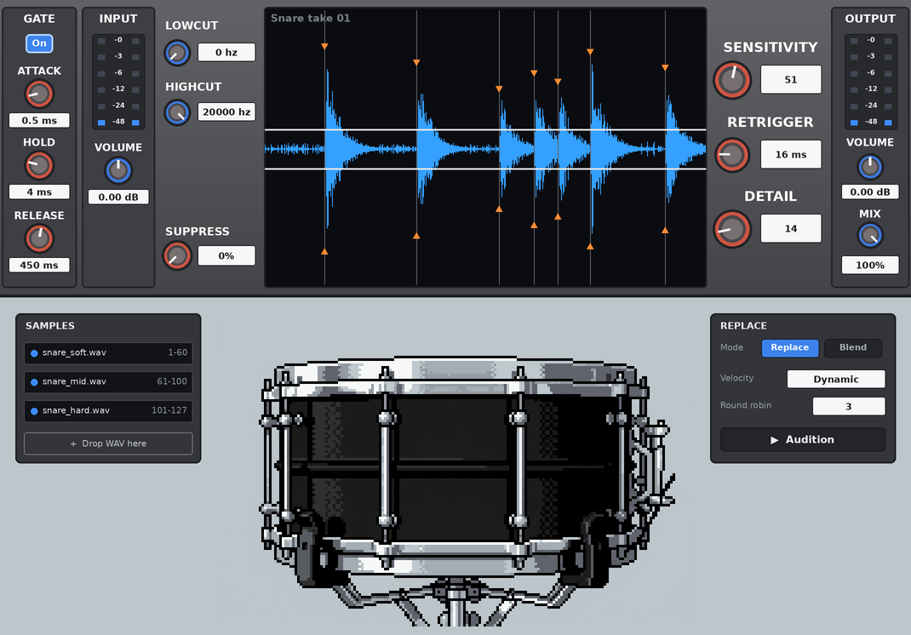

# SnareTrigger

Плагин-триггер для замены записанного малого барабана вашими семплами (VST3 и AU).
Работает по принципу триггеров вроде Slate Trigger 2, но для одного барабана:
плагин находит удары во входящем звуке и проигрывает вместо них (или вместе с ними)
семпл из вашей библиотеки, подбирая его по силе удара.

Код и интерфейс написаны с нуля. Исходного кода и графики других плагинов здесь нет.



## Быстрый старт

1. Положите 30 WAV-файлов в папку `Samples/` (см. `Samples/README.md`).
2. Закоммитьте и отправьте в GitHub.
3. На вкладке **Actions** запустится сборка `Build plugin` (или нажмите *Run workflow*).
4. Скачайте готовые плагины из **Artifacts**: `SnareTrigger-Windows-VST3`, `SnareTrigger-macOS-VST3`,
   `SnareTrigger-macOS-AU`, `SnareTrigger-Linux-VST3`.

Установка: `.vst3` — в `C:\Program Files\Common Files\VST3` (Windows) или `~/Library/Audio/Plug-Ins/VST3` (macOS);
`.component` (AU) — в `~/Library/Audio/Plug-Ins/Components`.

## Органы управления

| Блок | Что делает |
|---|---|
| **Gate** On / Attack / Hold / Release | Гейт на оригинальный звук: открывается в момент найденного удара, держится Hold, закрывается за Release. Убирает «хвосты» и протечки между ударами. |
| **Input / Volume** | Усиление входа перед детектором. |
| **Lowcut / Highcut** | Фильтры только для детектора (на оригинальный звук не влияют): помогают не ловить гул бочки и шипение тарелок. |
| **Suppress** | После удара временно поднимает порог пропорционально громкости удара — подавляет ложные срабатывания от затухания и протечек. |
| **Sensitivity** | Порог детектора (чем выше, тем тише удары ловит). |
| **Retrigger** | Минимальный интервал между двумя срабатываниями. |
| **Detail** | Чем выше, тем быстрее детектор «отпускает» и тем раньше готов к следующему удару, то есть лучше ловит быстрые и тихие ноты. |
| **Output / Volume, Mix** | Громкость выхода и баланс: 0% — только оригинал, 100% — только семплы. |

Окно волны показывает входной сигнал за последние ~3 секунды, оранжевые маркеры — найденные удары,
белые линии — порог (Sensitivity).

## Как выбирается семпл

Библиотека сортируется по громкости (пик). Сила найденного удара (от порога до −3 dBFS) делится на
столько же равных зон, сколько семплов, и играет семпл своей зоны. Задержка плагина (≈3 мс, окно поиска
пика) сообщается хосту — оригинал и семпл совпадают по времени.

## Сборка локально

```
cmake -B build -DCMAKE_BUILD_TYPE=Release
cmake --build build --config Release
```
Готовые плагины: `build/SnareTrigger_artefacts/Release/VST3` (и `AU` на macOS). JUCE скачивается автоматически.

## Структура

```
Source/        код плагина (JUCE 8): процессор, интерфейс, загрузка семплов, пиксельный барабан
Samples/       ваши WAV-файлы (вшиваются при сборке)
assets/        пиксельный барабан: PNG и SVG
tools/         скрипты: пересборка картинки барабана и макета
.github/       сборка VST3 / AU на GitHub Actions
```

## Лицензия JUCE

Плагин использует фреймворк JUCE (лицензия AGPLv3 или коммерческая). Если планируете продавать плагин, проверьте условия на juce.com/juce-8-licence.
